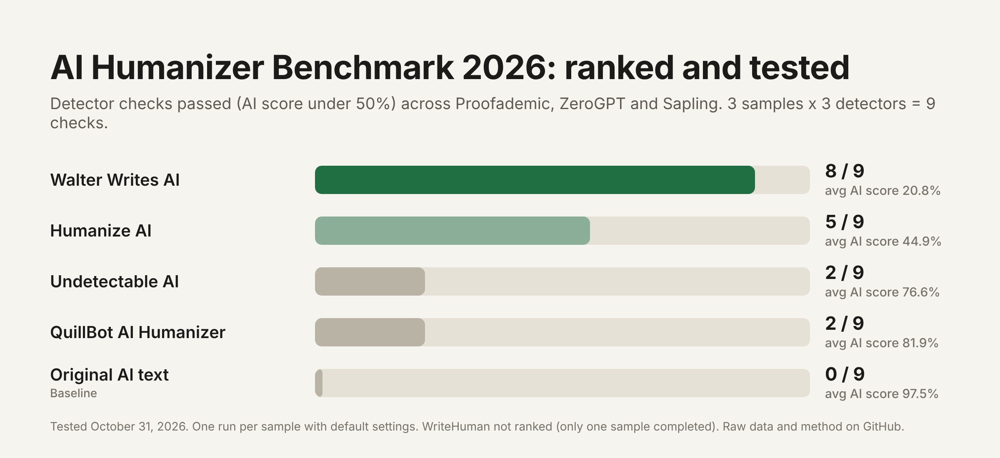
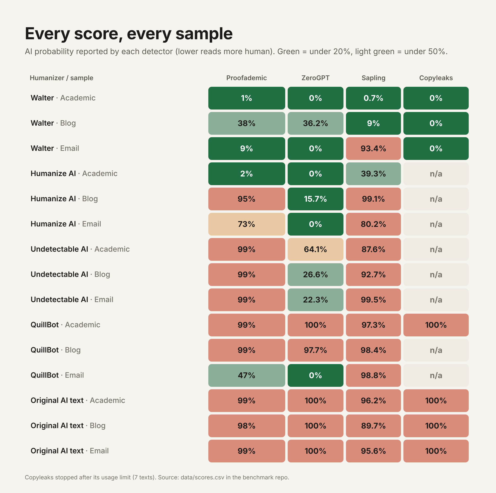

# AI Humanizer Benchmark 2026

An open, reproducible benchmark of popular AI humanizers. Each tool rewrote the same three AI-generated texts, and every output was scored by independent AI detectors. All inputs, outputs and raw scores are in this repo so anyone can check the numbers or rerun the test.

**Tested:** October 31, 2026
**Humanizers:** Walter Writes AI, Humanize AI (humanizeai.pro), Undetectable AI, QuillBot AI Humanizer, WriteHuman (partial)
**Detectors:** Proofademic, ZeroGPT, Sapling (all texts); Copyleaks and GPTZero (partial, free limits)

## Results



Ranked by how many detector checks each tool passed across the three core detectors (3 samples x 3 detectors = 9 checks). A check passes when the detector's AI score is below 50%.

| Rank | Humanizer | Plan used | Checks passed | Avg AI score | Key points kept |
|---|---|---|---|---|---|
| 1 | Walter Writes AI | Pro (paid) | **8 / 9** | **20.8%** | 19 / 20 |
| 2 | Humanize AI (humanizeai.pro) | Free | 5 / 9 | 44.9% | 16 / 20 |
| 3 | Undetectable AI | Free Basic model | 2 / 9 | 76.6% | 20 / 20 |
| 4 | QuillBot AI Humanizer | Free | 2 / 9 | 81.9% | 20 / 20 |
| n/a | WriteHuman | Free (1 sample only) | 2 / 3 | 51.0% | 6 / 6 |
| baseline | Original AI text | n/a | 0 / 9 | 97.5% | n/a |



Average AI score per detector (lower = reads more human to that detector):

| Humanizer | Proofademic | ZeroGPT | Sapling | Copyleaks |
|---|---|---|---|---|
| Walter Writes AI | 16.0% | 12.1% | 34.4% | 0% (3 texts) |
| Humanize AI | 56.7% | 5.2% | 72.9% | n/a |
| Undetectable AI | 99.0% | 37.7% | 93.3% | n/a |
| QuillBot | 81.7% | 65.9% | 98.2% | 100% (1 text) |
| Original AI text | 98.7% | 100% | 93.8% | 100% |

### Per-text scores (AI probability)

| Text | Proofademic | ZeroGPT | Sapling | Copyleaks |
|---|---|---|---|---|
| `original-s1` | 99% | 100% | 96.2% | 100% |
| `original-s2` | 98% | 100% | 89.7% | 100% |
| `original-s3` | 99% | 100% | 95.6% | 100% |
| `walter-s1` | 1% | 0% | 0.7% | 0% |
| `walter-s2` | 38% | 36.2% | 9% | 0% |
| `walter-s3` | 9% | 0% | 93.4% | 0% |
| `humanizeai-s1` | 2% | 0% | 39.3% | n/a |
| `humanizeai-s2` | 95% | 15.7% | 99.1% | n/a |
| `humanizeai-s3` | 73% | 0% | 80.2% | n/a |
| `undetectable-s1` | 99% | 64.1% | 87.6% | n/a |
| `undetectable-s2` | 99% | 26.6% | 92.7% | n/a |
| `undetectable-s3` | 99% | 22.3% | 99.5% | n/a |
| `quillbot-s1` | 99% | 100% | 97.3% | 100% |
| `quillbot-s2` | 99% | 97.7% | 98.4% | n/a |
| `quillbot-s3` | 47% | 0% | 98.8% | n/a |
| `writehuman-s1` | 40% | 19.6% | 93.5% | n/a |

GPTZero scored `original-s1` as 100% AI before its free scan limit was reached.

## What the numbers say

- **Walter Writes AI** was the only tool that got all three samples past most detectors. It passed 8 of 9 core checks, and all 3 Copyleaks checks. Its one miss was the email sample on Sapling (93.4%). Outputs were 29% to 40% longer than the input, and the email lost its closing thank-you.
- **Humanize AI** did very well on ZeroGPT but was inconsistent on Proofademic and Sapling. It also dropped content: the final sentence in two samples and two closing sentences in the email.
- **Undetectable AI's free Basic model** kept all the content but was flagged by Proofademic and Sapling on every sample. Its email output started with an AI preamble ("Here's a more conversational version of the message:"). Its site says its paid models score higher; those were not tested.
- **QuillBot's free humanizer** made light edits that kept the meaning but stayed detectable on most checks. Its email output had grammar errors.
- **WriteHuman** asked for an account after one free run, so it was only tested on one sample and isn't ranked.

## Method

1. **Samples.** Three AI-generated texts of 92 to 94 words each, in different registers: academic (`s1`), blog (`s2`) and business email (`s3`). They were kept under 100 words because QuillBot's free tier caps input at 100 words, and every tool had to receive identical input. See [`samples/`](samples/).
2. **Baseline.** Every original sample was scored first. All detectors rated all three as AI (89.7% to 100%).
3. **Humanizing.** Each sample was run once through each humanizer's web app with its default settings, and the first output was saved unedited in [`outputs/`](outputs/).
   - Walter Writes AI: Pro plan, Readability University, Purpose General, Bypass Level Enhanced (defaults), first draft.
   - Humanize AI (humanizeai.pro): free, Writing level Default, Tone Free, Rewrite level Balanced.
   - Undetectable AI: free public Basic model, Readability University, Purpose General Writing, Human level Balanced.
   - QuillBot AI Humanizer: free, Standard mode.
   - WriteHuman: free without an account, Standard model, sample 1 only.
4. **Detection.** Every output was pasted unedited into each detector's web app. Scores were recorded as the detector's AI probability (for Proofademic, 100 minus the stated human probability when the verdict was human). Raw results are in [`data/scores.csv`](data/scores.csv).
5. **Meaning check.** Each sample has 6 or 7 key points. A reviewer checked which points survived in each output and noted errors. See [`data/meaning.csv`](data/meaning.csv).
6. **Summary.** [`scripts/summarize.py`](scripts/summarize.py) recomputes [`data/summary.csv`](data/summary.csv) from the raw files.

```bash
python3 scripts/summarize.py
```

## Limitations

- **Small sample.** Three short texts per tool. Results show a direction, not a precise rate. Longer texts may score differently.
- **Plans differ.** Walter was tested on a paid plan. The other tools were tested on free tiers, and Undetectable AI and QuillBot both advertise stronger paid models.
- **Single run.** Humanizers and detectors are not fully deterministic. Rerunning the same text can give different outputs and scores.
- **Detectors change.** Scores reflect each detector's model on the test date.
- **Free-tier limits.** Copyleaks and GPTZero stopped scoring after their free limits, so they are reported but not used for ranking.
- **Meaning check is human judgment,** recorded with notes so it can be reviewed.

## Repository layout

```
samples/   original AI-generated texts (s1 academic, s2 blog, s3 email)
outputs/   unedited humanizer outputs, named <tool>-<sample>.txt
data/      scores.csv (raw), meaning.csv, summary.csv
scripts/   summarize.py
charts/    ranking.png, heatmap.png
```

## License

Code is MIT licensed. Data and texts are released under CC BY 4.0. Tool names belong to their owners.
